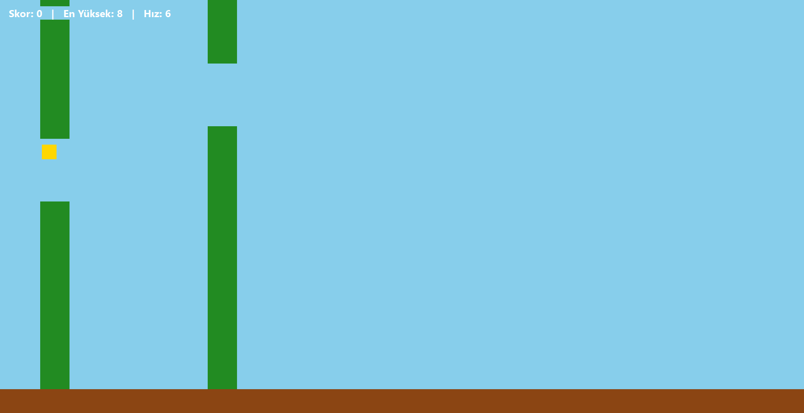
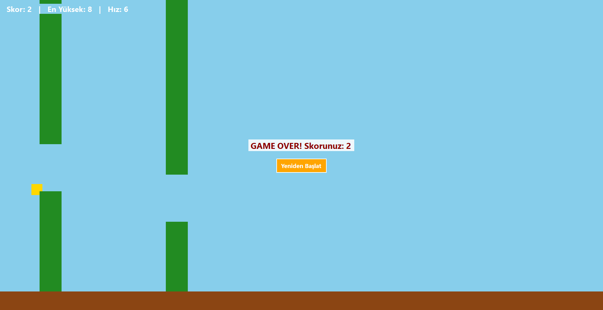

# YMH219-FlappyBird

Bu proje, **Fırat Üniversitesi Yazılım Mühendisliği Bölümü** **Nesne Tabanlı Programlama (YMH 219)** dersi kapsamında geliştirilmiş C# Windows Forms tabanlı bir Flappy Bird masaüstü oyunudur.

## Kullanılan Teknolojiler
* **Dil:** C#
* **Platform / Framework:** .NET Windows Forms (WinForms)
* **Geliştirme Ortamı:** Visual Studio 2026
* **Versiyon Kontrol:** Git & GitHub

## Kurulum ve Çalıştırma Adımları
1. Depoyu bilgisayarınıza klonlayın:
   `git clone https://github.com/yusuftugradeveci23/YMH219-FlappyBird.git`
2. İndirilen klasör içerisindeki `YMH219-FlappyBird/YMH219-FlappyBird.slnx` (veya `.csproj`) dosyasını Visual Studio ile açın.
3. Üst menüden **Derle > Çözümü Derle (Build Solution)** işlemini gerçekleştirin.
4. **F5** tuşuna basarak veya **Başlat (Start)** butonuna tıklayarak uygulamayı çalıştırın.

## Uygulamanın Temel Özellikleri
* **Nesne Tabanlı Mimari:** Oyun mantığı `Bird` (kuş fiziği), `PipePair` (engel çiftleri) ve `GameEngine` (skor, hız ve çarpışma yönetimi) sınıflarına ayrılmıştır.
* **Fizik ve Oyun Döngüsü:** `Timer` bileşeni ile 50 FPS akıcılıkta yer çekimi ve zıplama (`Space` / `Yukarı Ok`) mekanikleri uygulanmıştır.
* **Dinamik Zorluk ve Rekor Kaydı:** Her 5 puanda bir boru geçiş hızı artar; en yüksek skor yerel `highscore.txt` dosyasında kalıcı olarak saklanır.
* **Oyun Durum Yönetimi:** Çarpışma anında oyun durdurulur, Game Over ekranı gösterilir ve **Yeniden Başlat** buttonu ile oyun sıfırlanabilir.

## Ekran Görüntüleri

### Oynanış Ekranı

### Game Over ve Yeniden Başlatma Ekranı

## Bilinen Sınırlamalar ve Geliştirme Notları
* Oyun içi varlıklar (kuş, borular, zemin) harici görsel dosyası bağımlılığı olmaması adına renkli `PictureBox` bileşenleri ile tasarlanmıştır.
* İlerleyen sürümlerde ses efektleri ve farklı zorluk seviyesi seçenekleri eklenebilir.

## Öğrenci Bilgileri
* **Adı Soyadı:** Yusuf Tuğra Deveci
* **Öğrenci Numarası:** 250541095